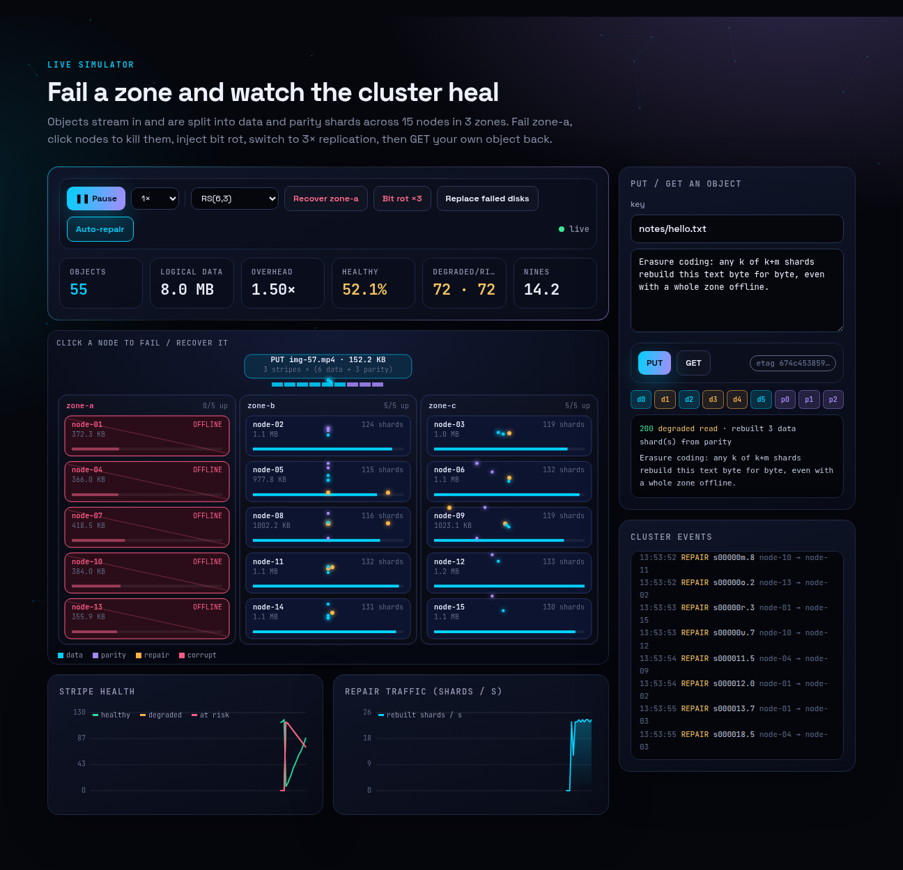
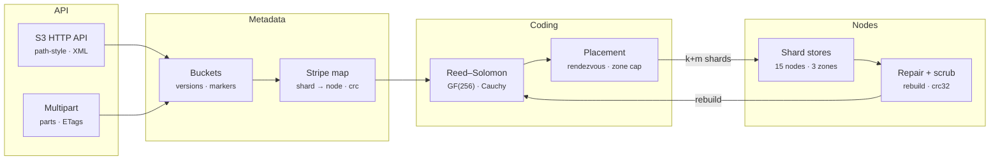
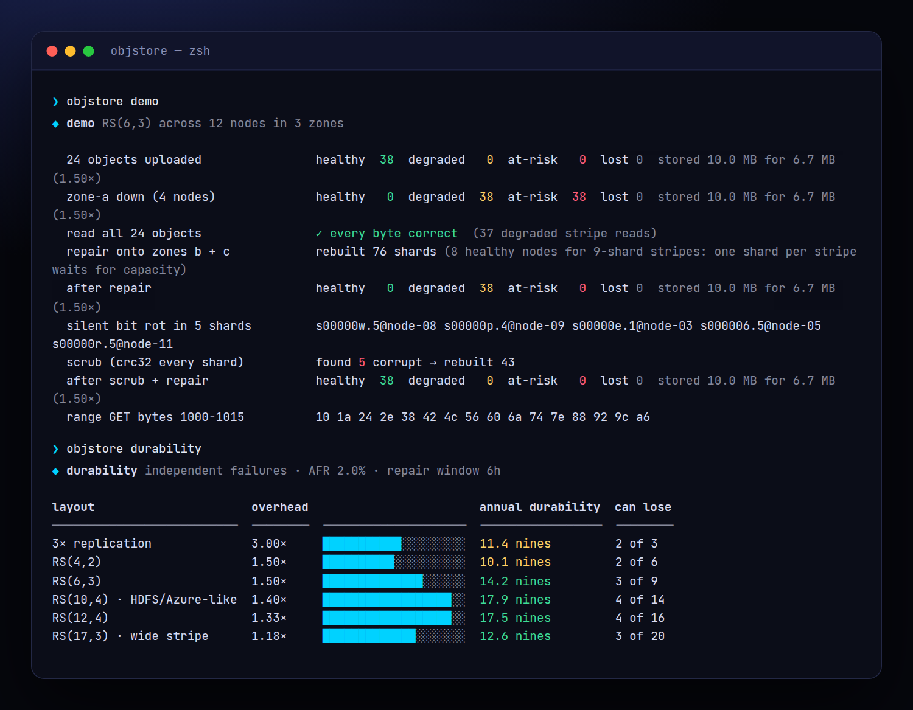
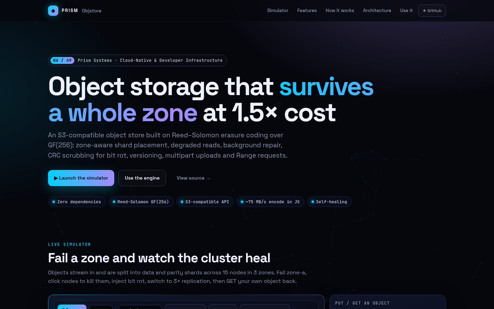
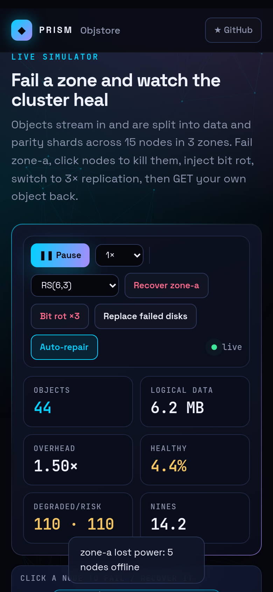

<!-- Prism Systems 06/49 -->
<p align="center">
  
</p>

<p align="center">
  
</p>

<p align="center">
  <a href="https://github.com/krishyaa06/prism-objstore/actions/workflows/ci.yml"></a>
  <a href="https://krishyaa06.github.io/prism-objstore/"></a>
  
  
  
  <a href="LICENSE"></a>
</p>

<p align="center">
  <a href="https://krishyaa06.github.io/prism-objstore/"><b>Live simulator</b></a> ·
  <a href="docs/ARCHITECTURE.md"><b>Architecture</b></a> ·
  <a href="docs/USAGE.md"><b>Docs</b></a> ·
  <a href="#-quick-start"><b>Quick start</b></a>
</p>

<p align="center">
  <a href="https://krishyaa06.github.io/prism-objstore/"></a>
</p>


## ⚡ Overview

Replicating every object three times is simple but triples your storage bill. Erasure coding gets better durability for far less: RS(6,3) stores 1.5× the data and survives any three lost shards, including a whole availability zone. Prism Objstore implements the full path that systems like MinIO, Ceph and Backblaze use: the Galois-field math, shard placement, degraded reads, repair, scrubbing, and the S3 API on top.

## ✨ Features

| | Feature | Details |
| :-: | --- | --- |
| ◫ | **Reed–Solomon coding** | Systematic RS(k, m) over GF(2^8) with a Cauchy parity matrix, so any k of the k+m shards reconstruct the data. Inverse matrices are cached per loss pattern. |
| ⌖ | **Zone-aware placement** | Rendezvous hashing picks k+m distinct nodes per stripe with at most ⌈n/zones⌉ per zone, so RS(6,3) over 3 zones survives losing any one zone. |
| ↯ | **Degraded reads** | Reads use the data shards when they are all online, otherwise rebuild the missing ones from parity on the fly. Range reads only touch the stripes they need. |
| ⟲ | **Background repair** | Budgeted repair rebuilds missing shards onto healthy nodes in the least-used zones and never co-locates two shards of a stripe. |
| ✓ | **Scrubbing** | Every shard carries a CRC-32. Reads skip corrupt shards and scrubs drop them, so silent bit rot is found and repaired before it adds up. |
| 🗂 | **S3 semantics** | Buckets, versioning with delete markers, ListObjectsV2 with prefix, delimiter and continuation, user metadata and MD5 ETags. |
| ⇪ | **Multipart uploads** | Out-of-order parts, ETag checks, unused parts freed on completion, and `md5(md5(p1)‖…)-N` ETags like S3. |
| ∞ | **Durability model** | Binomial loss model per repair window with AFR, which shows why RS(6,3) beats 3× replication at half the storage. |

## 🏗️ Architecture



### How it works

1. **Stripe** — Objects are cut into stripes (1 MiB by default). Each stripe is split into k equal data shards, zero-padded at the end.
2. **Encode** — m parity shards are computed as GF(256) linear combinations of the data shards (`dst ^= MUL[c][src]`).
3. **Place** — Rendezvous hashing ranks nodes per stripe. A per-zone cap spreads shards, and each shard is stored with its CRC-32.
4. **Read** — Collect shards from healthy nodes, drop any with a bad CRC, and use the fast path or invert the k×k sub-matrix to rebuild.
5. **Heal** — Repair finds stripes with missing shards, rebuilds them from any k survivors and writes them to new nodes. Scrubs catch bit rot.

More detail in [docs/ARCHITECTURE.md](docs/ARCHITECTURE.md).

## 🚀 Quick Start

**Try it in the browser:** [https://krishyaa06.github.io/prism-objstore/](https://krishyaa06.github.io/prism-objstore/), no install needed.

```bash
# CLI, no install
npx github:krishyaa06/prism-objstore --help

# add the engine to a project
npm install github:krishyaa06/prism-objstore
```

### JavaScript API

```js
import { ObjectStore, ReedSolomon, durability } from "prism-objstore";

const s3 = new ObjectStore({ k: 6, m: 3, nodes: 12, zones: 3 });
s3.createBucket("photos", { versioning: true });
s3.putObject("photos", "2026/cat.jpg", bytes, { contentType: "image/jpeg" });

for (const n of s3.nodes.filter((n) => n.zone === "zone-a")) s3.fail(n.id);   // lose a zone
const { body, etag } = s3.getObject("photos", "2026/cat.jpg");              // degraded read, still correct
s3.repair();                                                                 // rebuild missing shards
s3.scrub();                                                                  // find bit rot via CRC-32

// raw codec
const rs = new ReedSolomon(10, 4);
const shards = rs.encode(data);      // 14 shards
shards[2] = shards[7] = null;        // lose any 4
rs.reconstruct(shards); rs.join(shards, data.length);

durability({ k: 6, m: 3, afr: 0.02, repairHours: 6 });   // { overhead: 1.5, nines: 14.2 }
```

| Export | What it does |
|---|---|
| `new ObjectStore({ k, m, nodes, zones, stripeSize })` | Erasure-coded store over in-memory nodes |
| `createBucket(name, { versioning })` · `deleteBucket` · `setVersioning` | Buckets |
| `putObject(b, key, body, { contentType, meta })` · `getObject(b, key, { versionId, range, repair })` · `head` · `deleteObject` · `versions` · `list(b, { prefix, delimiter, maxKeys, startAfter })` | Objects |
| `createMultipart` · `uploadPart(id, n, body)` · `completeMultipart(id, parts)` · `abortMultipart` | Multipart uploads |
| `fail(node)` · `recover(node)` · `destroy(node)` · `bitrot()` · `health()` · `repair(budget)` · `scrub()` · `usage()` | Failure and healing |
| `new ReedSolomon(k, m)` · `.encode(data)` · `.reconstruct(shards)` · `.join(shards, len)` · `.verify(shards)` | Codec |
| `durability({ k, m, afr, repairHours })` · `gf` · `crc32` · `md5` | Math and checksums |
| `createServer(store)` from `src/node/server.js` | S3-compatible HTTP server |

### CLI

```bash
$ npx github:krishyaa06/prism-objstore demo
$ npx github:krishyaa06/prism-objstore encode photo.jpg --k 10 --m 4
$ npx github:krishyaa06/prism-objstore durability --afr 0.03 --repair 12
$ npx github:krishyaa06/prism-objstore serve --port 9000
$ curl -X PUT localhost:9000/photos && curl -T cat.jpg localhost:9000/photos/cat.jpg
$ curl -X POST localhost:9000/_admin/fail/node-01 && curl -r 0-99 localhost:9000/photos/cat.jpg
```

<p align="center"></p>

| Command | Description |
|---|---|
| `objstore serve [--port 9000] [--k --m --nodes --zones]` | Start the S3-compatible API with `/_admin/{fail,recover,repair,scrub,health}` |
| `objstore encode <file> [--k --m]` | Show shards, drop m at random, rebuild and verify MD5 |
| `objstore demo [--k --m]` | Zone outage, degraded reads, repair, bit rot and scrub |
| `objstore durability [--afr --repair]` | Compare layouts with 3× replication |
| `objstore bench [--mb --k --m]` | Encode and rebuild throughput |

## 📸 Screenshots

<table>
  <tr>
    <td width="68%"></td>
    <td width="32%"></td>
  </tr>
</table>

## 🧠 Design Decisions

- **Systematic code.** Data shards are stored unmodified, so healthy reads are a memcpy. Parity rows come from a Cauchy matrix `1/(x_i ⊕ y_j)`, which guarantees every k×k sub-matrix is invertible.
- **Table-driven GF(256).** A 64 KB multiplication table turns the inner loop into `dst[i] ^= MUL[c<<8 | src[i]]`, about 75 MB/s per core in plain JavaScript.
- **Placement with zone caps.** Rendezvous hashing keeps placement stable as nodes come and go. A cap of ⌈(k+m)/zones⌉ per zone turns "survive m failures" into "survive a zone".
- **Repair never co-locates.** If there are not enough distinct healthy nodes, a stripe stays degraded instead of putting two shards on one node and silently lowering fault tolerance.
- **Integrity first.** CRC-32 per shard means corrupt shards are treated as missing, so bit rot can never be decoded into wrong data.

## 🏭 Production Notes

The coding, placement and healing logic is complete. A real deployment also needs:

- Persistent shard stores (one file or RocksDB key per shard on each disk) and a replicated metadata service (etcd, FoundationDB or Raft) for the stripe map.
- SigV4 request signing, IAM-style bucket policies and TLS in front of the HTTP API.
- SIMD (ISA-L, `klauspost/reedsolomon`) or WASM for multi-GB/s coding, and streaming encode for objects larger than memory.
- Repair throttling by bandwidth, failure detection with heartbeats and a delay before declaring a node lost.

## 📁 Project Structure

```text
prism-objstore/
├── assets/
│   └── logo.svg
├── bin/
│   └── objstore.js
├── css/
│   └── app.css
├── docs/
│   ├── ARCHITECTURE.md
│   └── USAGE.md
├── examples/
│   └── hello.txt
├── js/
│   └── app.js
├── src/
│   ├── lib/
│   │   ├── cli.js
│   │   ├── hash.js
│   │   └── rng.js
│   ├── node/
│   │   └── server.js
│   ├── checksum.js
│   ├── gf256.js
│   ├── index.js
│   ├── rs.js
│   └── store.js
├── test/
│   └── objstore.test.js
├── .gitignore
├── LICENSE
├── README.md
├── index.html
└── package.json
```

## 🧪 Tests

```bash
npm test
```

The test suite uses the built-in `node:test` runner, so there is nothing to install. CI runs it on Node 20 and 22.

## 🗺️ Roadmap

- [ ] Disk-backed shard stores + Raft metadata
- [ ] SigV4 authentication
- [ ] Streaming encode for large objects
- [ ] Lifecycle rules and storage classes

## 🤝 Contributing

1. Fork the repo and create a branch: `git checkout -b feat/my-idea`
2. Make your change in `src/` and add a test in `test/`
3. Run `npm test`, then open a Pull Request

## 🔷 Part of Prism Systems

**Prism Objstore** is system **06 of 49** in **Prism Systems**, a series of open-source reference implementations of large-scale infrastructure by [Prism Protocol](https://dc.gg/prismprotocol). Each one ships a real engine, a CLI and a live simulator, all with zero dependencies.

## 👤 Author

<table>
  <tr>
    <td align="center">
      <a href="https://github.com/krishyaa06"><br><b>Soumya Bhandare</b></a><br>
      <sub>Founder @ Prism Protocol</sub>
    </td>
    <td>
      <a href="https://dc.gg/prismprotocol"></a><br>
      <a href="https://instagram.com/prism_protocol_"></a><br>
      <a href="https://x.com/krishyaa06"></a>
    </td>
  </tr>
</table>

## 📄 License

Released under the [MIT License](LICENSE).

<p align="center">
  <b>If this helped you learn something, consider giving it a ⭐</b><br>
  <sub>"Build. Create. Compete." · Made with ⚡ by Prism Protocol</sub>
</p>


