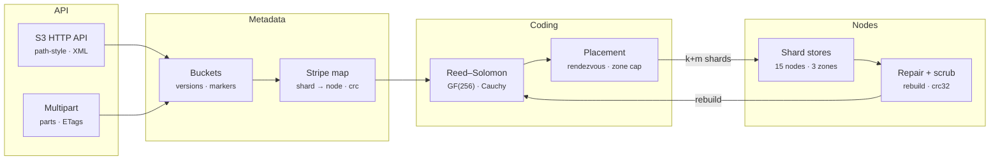

# Prism Objstore — Architecture

Replicating every object three times is simple but triples your storage bill. Erasure coding gets better durability for far less: RS(6,3) stores 1.5× the data and survives any three lost shards, including a whole availability zone. Prism Objstore implements the full path that systems like MinIO, Ceph and Backblaze use: the Galois-field math, shard placement, degraded reads, repair, scrubbing, and the S3 API on top.

## System diagram

## How it works

1. **Stripe** — Objects are cut into stripes (1 MiB by default). Each stripe is split into k equal data shards, zero-padded at the end.
2. **Encode** — m parity shards are computed as GF(256) linear combinations of the data shards (`dst ^= MUL[c][src]`).
3. **Place** — Rendezvous hashing ranks nodes per stripe. A per-zone cap spreads shards, and each shard is stored with its CRC-32.
4. **Read** — Collect shards from healthy nodes, drop any with a bad CRC, and use the fast path or invert the k×k sub-matrix to rebuild.
5. **Heal** — Repair finds stripes with missing shards, rebuilds them from any k survivors and writes them to new nodes. Scrubs catch bit rot.

## Design decisions

- **Systematic code.** Data shards are stored unmodified, so healthy reads are a memcpy. Parity rows come from a Cauchy matrix `1/(x_i ⊕ y_j)`, which guarantees every k×k sub-matrix is invertible.
- **Table-driven GF(256).** A 64 KB multiplication table turns the inner loop into `dst[i] ^= MUL[c<<8 | src[i]]`, about 75 MB/s per core in plain JavaScript.
- **Placement with zone caps.** Rendezvous hashing keeps placement stable as nodes come and go. A cap of ⌈(k+m)/zones⌉ per zone turns "survive m failures" into "survive a zone".
- **Repair never co-locates.** If there are not enough distinct healthy nodes, a stripe stays degraded instead of putting two shards on one node and silently lowering fault tolerance.
- **Integrity first.** CRC-32 per shard means corrupt shards are treated as missing, so bit rot can never be decoded into wrong data.

## Production notes

The coding, placement and healing logic is complete. A real deployment also needs:

- Persistent shard stores (one file or RocksDB key per shard on each disk) and a replicated metadata service (etcd, FoundationDB or Raft) for the stripe map.
- SigV4 request signing, IAM-style bucket policies and TLS in front of the HTTP API.
- SIMD (ISA-L, `klauspost/reedsolomon`) or WASM for multi-GB/s coding, and streaming encode for objects larger than memory.
- Repair throttling by bandwidth, failure detection with heartbeats and a delay before declaring a node lost.
